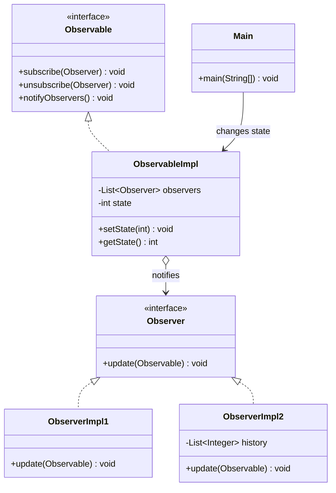
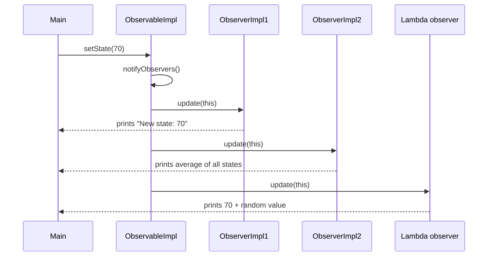
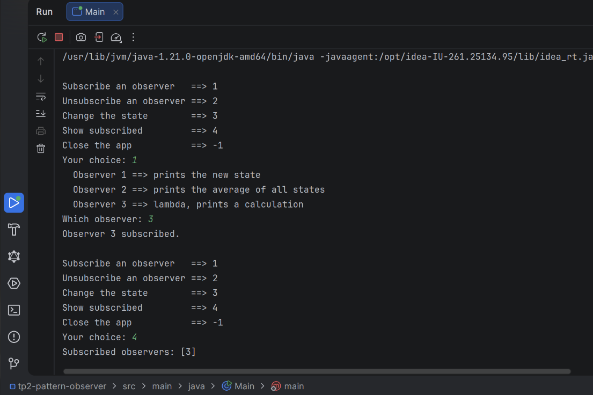

# TP2 — Observer Design Pattern

A small Java console app that demonstrates the **Observer** design pattern. One object (the **observable**) holds a state. When that state changes, it automatically notifies every object that subscribed to it (the **observers**).

## What is the Observer pattern?

It defines a **one-to-many** link: when one object changes, all the objects that depend on it are told about the change, without the observable needing to know what they do with it.

- **Observable** (also called *subject*): holds the state and the list of subscribers.
- **Observer**: anything that wants to be told when the state changes.
- **Subscribe / unsubscribe**: observers can join or leave at any time.

**Use case:** a YouTube channel. When it uploads a video (state change), every subscriber gets a notification. Each subscriber reacts in its own way (watch now, save for later, ignore), and the channel doesn't care how.

## Class diagram



## Notification flow



## Project structure

```
src/main/java/
├── Main.java                 # Interactive menu
└── obs/
    ├── Observable.java       # Observable interface
    ├── Observer.java         # Observer interface (@FunctionalInterface)
    ├── ObservableImpl.java   # Holds the state and the subscribers
    ├── ObserverImpl1.java    # Prints the new state
    └── ObserverImpl2.java    # Prints the average of all states
```

## How it works

| Class | Role |
|---|---|
| `Observable` | Interface: `subscribe`, `unsubscribe`, `notifyObservers` |
| `Observer` | Interface with one method, `update(Observable)`. Marked `@FunctionalInterface`, so it can be written as a lambda |
| `ObservableImpl` | Stores an `int state` and a list of observers. `setState()` saves the value, then calls `notifyObservers()` |
| `ObserverImpl1` | Prints the new state |
| `ObserverImpl2` | Keeps a history of every state and prints their average |
| Observer 3 (lambda) | Created in `Main`, prints `state + random(0..100)` |

### Pull model

`update()` receives the observable itself, not the new value. Each observer **pulls** what it needs with `getState()`:

```java
public void update(Observable observable) {
    if (observable instanceof ObservableImpl obs) {
        System.out.println("New state: " + obs.getState());
    }
}
```

The `instanceof` check with a pattern variable (`obs`) makes sure the cast is safe before calling `getState()`.

### Loading observers in `Main`

Like the Strategy TP, observers 1 and 2 are created **by name with reflection**:

```java
Observer o = (Observer) Class.forName("obs.ObserverImpl" + n)
        .getConstructor()
        .newInstance();
```

- The name must include the package: `obs.ObserverImpl1`, not `ObserverImpl1`.
- Observer 3 is a lambda, so it has no class to load and is built directly.

`Main` stores each created observer in a `Map<Integer, Observer>`. This matters because `unsubscribe()` uses `List.remove(o)`, which only removes the **same object** that was subscribed. A new `ObserverImpl1()` would be a different object and wouldn't be removed.

## Run it

Requires **Java 21** and **Maven**.

```bash
mvn compile
java -cp target/classes Main
```

## Example session


```
Subscribe an observer   ==> 1
Unsubscribe an observer ==> 2
Change the state        ==> 3
Show subscribed         ==> 4
Close the app           ==> -1
Your choice: 1
  Observer 1 ==> prints the new state
  Observer 2 ==> prints the average of all states
  Observer 3 ==> lambda, prints a calculation
Which observer: 2
Observer 2 subscribed.

Your choice: 3
New state: 60
================= Observer Impl 2 ====================
The average is: 60.0
======================================================

Your choice: 3
New state: 80
================= Observer Impl 2 ====================
The average is: 70.0
======================================================
```

Enter `-1` to quit.